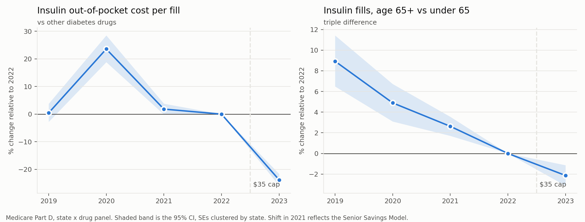

# Medicare $35 Insulin Cap: Program Evaluation

Did the Inflation Reduction Act's $35 monthly cap on Part D insulin cost sharing, which started January 2023, lower what beneficiaries paid and raise insulin use?

## Bottom line

| Question | Answer | How sure |
|---|---|---|
| Did members pay less? | **Yes.** Out-of-pocket cost per insulin fill fell from $19.43 to $14.28 in 2023 (−26%). Over the same year, other diabetes drugs rose 12%. Against insulin's own trend, the drop is −24%. | High |
| Did insulin use rise? | **Modestly.** Fills came in about **+4%** above insulin's pre-cap trend (95% CI +3.0% to +4.6%). Every specification is positive, ranging from +4% to +8%. | Moderate. Trend fitting carries about ±3 points of error (see the DPP-4 placebo) |
| Was it concentrated where the cap should bite most? | **Not detectably.** The 65+ versus under-65 comparison shows a steady drift and no break in 2023. | This check does not confirm the mechanism |

The simple difference-in-differences estimate is **−7%**. That estimate is wrong, and this project shows why: it fails its own pre-trend and placebo checks. The repo keeps that first design on purpose, because diagnosing it is part of the evaluation.



## Data

**Source:** CMS [Medicare Part D Prescribers by Geography and Drug](https://data.cms.gov/provider-summary-by-type-of-service/medicare-part-d-prescribers/medicare-part-d-prescribers-by-geography-and-drug), 2019 to 2023. 2024 is not yet posted.

The file has one row per state, brand and year, with:
- claims and 30-day fills
- total drug cost
- beneficiary cost sharing, split by low-income subsidy (LIS) status
- a 65+ breakout

**Analysis panel:**
- 51 jurisdictions (50 states plus DC)
- 44 drugs, including 12 insulin generics
- 1,868 state-by-drug units
- 427M claims over five years

The cost sharing columns measure out-of-pocket cost directly. That makes it possible to confirm the cap reached the pharmacy counter (the first stage) before asking what it did to use.

**Groups:**
- **Treated:** insulin products.
- **Comparison:** metformin, sulfonylureas, DPP-4 inhibitors, SGLT2 inhibitors, TZDs and other oral drugs.
- **Excluded:** GLP-1s, because obesity-driven demand broke their trend from 2021 on. Insulin and GLP-1 combinations, insulin delivery devices and supplies are also excluded.

## How the design evolved

### 1. Level difference-in-differences: rejected

**Setup.** This compares insulin with the other diabetes drugs in the same state and year:
- unit fixed effects plus state-by-year fixed effects
- standard errors clustered by state
- weighted by baseline claims

**Result.** The estimate was −7% fills.

**Why it was rejected:**
- **Pre-trends fail.** The joint pre-trend test gives p < 0.001.
- **Timing placebo fails.** A fake 2021 start gives −8%.
- **Drug class placebo fails.** Making DPP-4s the fake treated group gives −20%.

The cause shows up in the raw data. From 2019 to 2022, insulin claims fell about 4% a year as patients moved to newer drugs. Control drug claims rose over the same period. A level DiD reads that pre-existing decline as an effect of the cap.

### 2. Trend break: main estimate

**Setup.** Each drug class gets its own linear trend. The effect is how far insulin's 2023 value sits from its own trend line.

| Spec | Fills vs trend |
|---|---|
| Main (weighted) | **+3.8%** (3.0 to 4.6) |
| Claims instead of fills | +4.1% |
| Senior Savings Model years given their own shift | +6.5% |
| Unweighted | +8.1% |
| Placebo: fake break in 2022 | −0.04% (p = 0.85), **passes** |
| Placebo: DPP-4 as fake treated | −3.0%, **fails modestly** |

**How to read the placebos:**
- The timing placebo passing means insulin's trend was stable right up to the cap.
- The DPP-4 placebo shows linear trends don't fit every drug class perfectly. Treat the effect size as roughly ±3 points.
- The direction holds in every specification.

### 3. Triple difference by age: no confirmation

**The idea.** Under-65 Medicare enrollees qualify through disability and are mostly on the low-income subsidy, which already capped their copays. So the cap should have mattered more for 65+.

**What the data shows.** The 65+ versus under-65 gap for insulin drifted steadily from 2019 to 2023: +8.9%, +4.9%, +2.6%, 0 and −2.1% relative to 2022. There is no break at the cap.

**Why that doesn't settle it.** This check can't confirm the mechanism, but it doesn't contradict a small overall effect either:
- many under-65 enrollees without the subsidy were also treated
- state-level data can't separate members by subsidy status

## Implications for plan design

- **Copay caps pass through.** The cost reduction showed up in member out-of-pocket spending within the first year.
- **Expect a modest volume response.** Use rose a few percent, not a step change. A business case for a cap should rest on member cost burden and adherence, not on fill volume.
- **Measure at the member level.** That means proportion of days covered, discontinuation and downstream outcomes. Choose comparison groups whose pre-period trends actually match. In this data, other diabetes drugs did not.

## Known threats

- **Senior Savings Model (2021 to 2022).** This voluntary pilot already capped insulin in participating plans, so part of the effect was in place before 2023. That biases the estimates toward zero.
- **Manufacturer list price cuts in 2023 and 2024.** These move total cost more than cost sharing under the cap. Total cost is reported but is not an outcome.
- **State-level aggregates.** These estimate average use, not adherence. They also can't split low-income subsidy members from other members.
- **One post-cap year.** The 2024 file, when CMS posts it, will show whether the break persists.

## Run it

```bash
pip install -r requirements.txt
python src/01_download.py      # ~70 MB of CSVs into data/raw
python src/02_build_panel.py   # DuckDB SQL, balanced panel, descriptive trends
python src/03_did.py           # level DiD and its checks (rejected design, kept on purpose)
python src/04_respecify.py     # trend break and age triple difference
```

## Repo layout

```
sql/build_panel.sql      cohort definition and panel build (DuckDB)
src/01_download.py       pulls the CMS files
src/02_build_panel.py    runs the SQL and writes descriptive trends
src/03_did.py            level DiD, event study, placebos, robustness
src/04_respecify.py      trend break, triple difference, final chart
docs/executive_brief.md  one-page summary for decision makers
output/                  results tables, event study charts, results JSON
```
